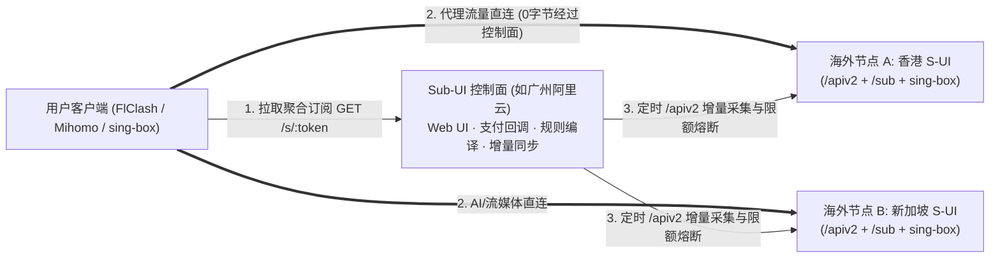

# Sub-UI

基于 **Go + React 19 + TypeScript + Rsbuild + Tailwind CSS 4** 构建的下一代 **S-UI 多节点订阅聚合、ACL 分流定制、全局流量配额与自助缴费控制面板**。

> 单二进制、零外部依赖（内置 SQLite WAL，可选 PostgreSQL），轻量常驻内存 < 40 MB，专为 1GB~2GB 轻量云服务器（如国内阿里云/腾讯云作为控制面，海外香港/新加坡等多台 [alireza0/s-ui](https://github.com/alireza0/s-ui) 作为边缘数据面）架构设计。

---

## 核心特性

- **多节点订阅聚合 & 带密钥专属订阅 (`/s/:token`)**
  - 自动聚合多个远端 S-UI 节点及外部订阅源，支持按地区前缀命名、UDP 与 **TFO (TCP Fast Open) 0-RTT** 保留。
  - 每个用户拥有独立高熵 `sub_token`，支持用户/管理员随时轮换密钥；自动识别 `User-Agent` 并按需输出 **Clash.Meta / Mihomo YAML**、**Sing-box JSON** 或 **Base64 / Plain URI**，完整携带 `Subscription-Userinfo` 等标准响应头。
- **分布式流量统计、限额熔断与周期重置（控制面与节点物理分离）**
  - 针对**控制面部署在国内（如广州阿里云）、代理节点在海外（如香港 / 新加坡）**的经典分离拓扑设计，**用户代理流量 100% 直连海外 S-UI，零字节经过控制面服务器**。
  - 通过 S-UI 原生 `/apiv2` 实现双向增量同步、多节点计费倍率（如香港 1.0x、新加坡 1.5x）、全局超额/到期即时跨节点禁用并调用 `/apiv2/closeSessions` 踢出活跃连接、单用户精确周期重置，并支持配置每节点 `api_proxy` 应对跨境网络波动。
- **ACL4SSR 全分组规则与分层微调覆盖（Rule Override Studio）**
  - 内置 `ACL4SSR 全分组完整版`、`AI & 流媒体分流专版`、`ACL4SSR 精简版` 等预设，且支持直接解析导入任意 Subconverter `.ini` 规则链接。
  - **支持管理员全局覆写 + 用户个人规则微调**：前置最高优先级规则（Prepend）、后置规则（Append）、整组改道（Group Rewrites，例如仅需一键将 `💬 AI 平台` 定向至 `🇸🇬 狮城节点`）、禁用特定 RuleSet、TFO/去广告/DNS 模式切换，并提供**实时域名命中模拟器**与 **YAML/JSON 编译预览**。
- **订阅商店、多渠道支付与卡密兑换**
  - 插件化支付网关：原生支持 **易支付通用协议 (Epay)**、**支付宝当面付 (RSA2)**、**微信支付 Native V3 (AES-256-GCM)**、**账户余额**、**卡密兑换码 (CDK)** 以及开发调试专用的**沙箱测试模式**。
- **完整权限隔离 & 注册策略**
  - 独立管理员控制台与用户工作台；支持开放注册 / 关闭注册 / **强制邀请码注册**、批量邀请码生成（支持附赠试用天数与流量）。
  - 界面视觉体系采用 OKLCH 语义色板，提供多种主题预设、明暗双模及排版字号/圆角实时切换。

---

## 控制面与边缘节点分离架构



### 工作机制要点

1. **增量流量采集（Delta Polling）**：Sub-UI 每 30 秒并发拉取各节点 S-UI `/apiv2/clients` 与 `/apiv2/onlines`，通过本地记录的 `last_raw_up` / `last_raw_down` 游标计算增量字节（自动兼容节点侧外部清零），乘以节点倍率累加至用户全局配额。
2. **全集群实时熔断**：一旦用户的 `全局已用 >= 套餐限额` 或 `当前时间 >= 到期时间`，Sub-UI 立即向其名下所有节点下发 `enable: false` 并触发 `POST /apiv2/closeSessions` 立即断开长连接；同时向各节点下发动态安全兜底配额 `volume`，即使控制面短暂离线，边缘节点也不会超刷。
3. **单用户无干扰重置**：周期重置时，Sub-UI 利用 S-UI `/apiv2/save`（对单客户端传入 `up: 0, down: 0`）仅将该用户在 S-UI 的当期流量滚存至 `totalUp/totalDown` 并恢复可用状态，绝不影响同一台 S-UI 上的其他用户。

---

## 快速部署

### 1. Docker Compose 部署（推荐）

```bash
git clone https://github.com/TakotsuboChen/sub-ui.git
cd sub-ui
cp .env.example .env
# 按需修改 .env 中的 SUBUI_PUBLIC_URL 等参数
docker compose up -d
```

服务默认监听 `8080` 端口。首次访问面板会自动进入**初始化向导**创建超级管理员账号。

### 2. Nginx / OpenResty 反向代理配置示例

```nginx
server {
    listen 443 ssl http2;
    server_name sub.example.com;

    location / {
        proxy_pass http://127.0.0.1:8080;
        proxy_set_header Host $host;
        proxy_set_header X-Real-IP $remote_addr;
        proxy_set_header X-Forwarded-For $proxy_add_x_forwarded_for;
        proxy_set_header X-Forwarded-Proto $scheme;
    }
}
```

### 3. 本地源码构建与测试

要求：Go >= 1.24，Node.js >= 20，pnpm >= 9。

```bash
# Linux / macOS
bash scripts/build.sh

# Windows PowerShell
pwsh -File scripts/build.ps1
```

运行全套后端单元测试与集成测试：

```bash
go test -v ./...
```

---

## 接入远端 S-UI 节点指南

1. 登录各个海外服务器上的 S-UI 面板，进入 **Admin -> API Tokens** 创建一个 API Token。
2. 在 Sub-UI 管理后台进入 **S-UI 节点集群 -> 添加 S-UI 节点**：
   - **S-UI 面板根路径**：填写 S-UI 面板地址（含 `webPath`，如 `https://hk.example.com:2095/app`）。
   - **APIv2 Token**：粘贴刚刚生成的 Token。
   - **入站 ID 列表**：点击“入站 / 纳管老用户”可实时查看远端入站 ID（如 `[1, 2]`），或将老用户一键绑定到 Sub-UI 账户。
   - **API 请求代理（可选）**：若控制面服务器直连远端面板港/新端口偶发超时，可填写 `socks5://127.0.0.1:1080` 等内部通道代理。

---

## 开源协议

本项目基于 [MIT License](LICENSE) 开源。
